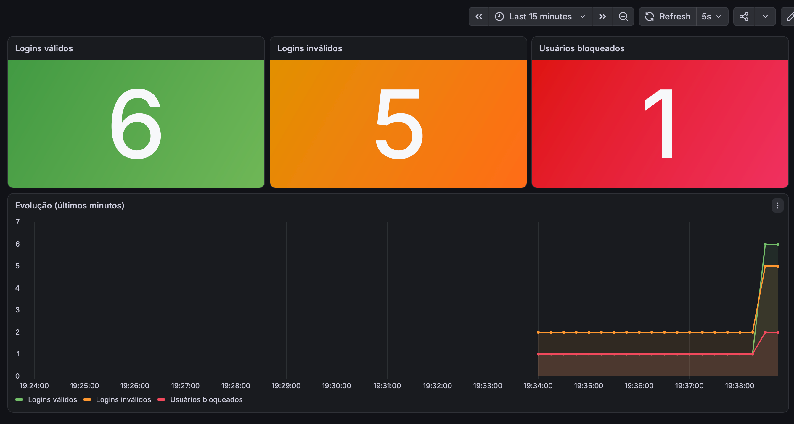

# MS-AV-02 - Segurança e Observabilidade

Mecanismo de login RESTful em Spring Boot com bloqueio por tentativas, controle de acesso por *roles* (`JdbcUserDetailsManager`), métricas no Prometheus/Grafana e documentação OpenAPI/Swagger.

**Aluno:** Nicollas Câmara Fortunato

## Tecnologias

- Java 17 / Spring Boot 4.1.1
- Spring Security (HTTP Basic + `JdbcUserDetailsManager`)
- Spring JDBC + H2 (em memória)
- Spring Boot Actuator + Micrometer (Prometheus)
- Grafana
- springdoc-openapi (Swagger UI)

## End-points

| Método | Rota | Acesso | Descrição |
|---|---|---|---|
| POST | `/login` | Público | Corpo `{"username": "", "senha": ""}` → **200** (válido) ou **401** (inválido / bloqueado) |
| PUT | `/trocarsenha/{userid}` | Público | Corpo `{"atual": "", "nova": ""}` → confere a senha atual e grava a nova |
| POST | `/` | `ROLE_MANUTENCAO` | Cadastra usuário `{"username": "", "senha": ""}` |
| GET | `/` | `ROLE_MANUTENCAO` | Lista todos os usuários (JSON) |
| PUT | `/unlock/{userid}` | `ROLE_ADMIN` | Desbloqueia o usuário |

### Regras

- A validação do `/login` e do `/trocarsenha` é feita na tabela **usuarios**.
- Se o usuário falhar **mais de uma vez** no login (2ª falha), ele é **bloqueado** na tabela **login_attempts**. Um login válido zera as falhas.
- Usuário bloqueado recebe **401** mesmo com a senha correta, até ser desbloqueado via `/unlock/{userid}`.
- Os end-points protegidos usam **HTTP Basic** com os usuários das tabelas `users` / `authorities` (schema padrão do `JdbcUserDetailsManager`).

### Usuários de teste

| Tabela | Usuário | Senha | Uso |
|---|---|---|---|
| `users` | `admin` | `admin` | `ROLE_ADMIN` → `/unlock` |
| `users` | `manutencao` | `manutencao` | `ROLE_MANUTENCAO` → `GET /` e `POST /` |
| `usuarios` | `joao` | `123` | login |
| `usuarios` | `maria` | `456` | login |
| `usuarios` | `pedro` | `789` | login |

## Métricas

Expostas em `http://localhost:8080/actuator/prometheus`:

| Métrica | Tipo | Significado |
|---|---|---|
| `login_validos_total` | Counter | Quantidade de logins válidos |
| `login_invalidos_total` | Counter | Quantidade de logins inválidos |
| `usuarios_bloqueados` | Gauge | Total de usuários bloqueados (consulta a tabela `login_attempts`) |

## Como executar

### 1. Aplicação

```bash
mvn spring-boot:run
```

- Swagger UI: http://localhost:8080/swagger-ui.html
- Console H2: http://localhost:8080/h2-console (JDBC URL `jdbc:h2:mem:logindb`, usuário `sa`, senha `password`)

### 2. Prometheus

Em outro terminal, dentro da pasta `observabilidade`:

```bash
prometheus --config.file=prometheus.yml
```

Acessar http://localhost:9090 e conferir em *Status > Targets* que o `login-service` está **UP**.

### 3. Grafana

```bash
brew services start grafana
```

1. Acessar http://localhost:3000 (usuário `admin` / senha `admin`)
2. *Connections > Data sources > Add data source > Prometheus* → URL `http://localhost:9090` → *Save & test*
3. *Dashboards > New > Import* → enviar `observabilidade/grafana-dashboard.json` → selecionar o data source Prometheus → *Import*

## Testes rápidos (curl)

```bash
# login válido -> 200
curl -i -X POST localhost:8080/login -H "Content-Type: application/json" -d '{"username":"joao","senha":"123"}'

# duas falhas seguidas -> 401 e usuário bloqueado
curl -i -X POST localhost:8080/login -H "Content-Type: application/json" -d '{"username":"maria","senha":"errada"}'
curl -i -X POST localhost:8080/login -H "Content-Type: application/json" -d '{"username":"maria","senha":"errada"}'

# mesmo com a senha correta continua 401 (bloqueado)
curl -i -X POST localhost:8080/login -H "Content-Type: application/json" -d '{"username":"maria","senha":"456"}'

# listar usuários (ROLE_MANUTENCAO)
curl -i -u manutencao:manutencao localhost:8080/

# sem a role correta -> 403
curl -i -u admin:admin localhost:8080/

# desbloquear (ROLE_ADMIN)
curl -i -u admin:admin -X PUT localhost:8080/unlock/maria

# cadastrar usuário (ROLE_MANUTENCAO)
curl -i -u manutencao:manutencao -X POST localhost:8080/ -H "Content-Type: application/json" -d '{"username":"ana","senha":"abc"}'

# trocar senha
curl -i -X PUT localhost:8080/trocarsenha/joao -H "Content-Type: application/json" -d '{"atual":"123","nova":"nova123"}'
```

## Dashboard Grafana



O dashboard exportado está em [`observabilidade/grafana-dashboard.json`](observabilidade/grafana-dashboard.json).

## Observação sobre o script SQL

O script do enunciado tinha uma vírgula sobrando antes do `)` na tabela `login_attempts`, o que gera erro de sintaxe no H2. Ela foi removida em `src/main/resources/schema.sql`.
